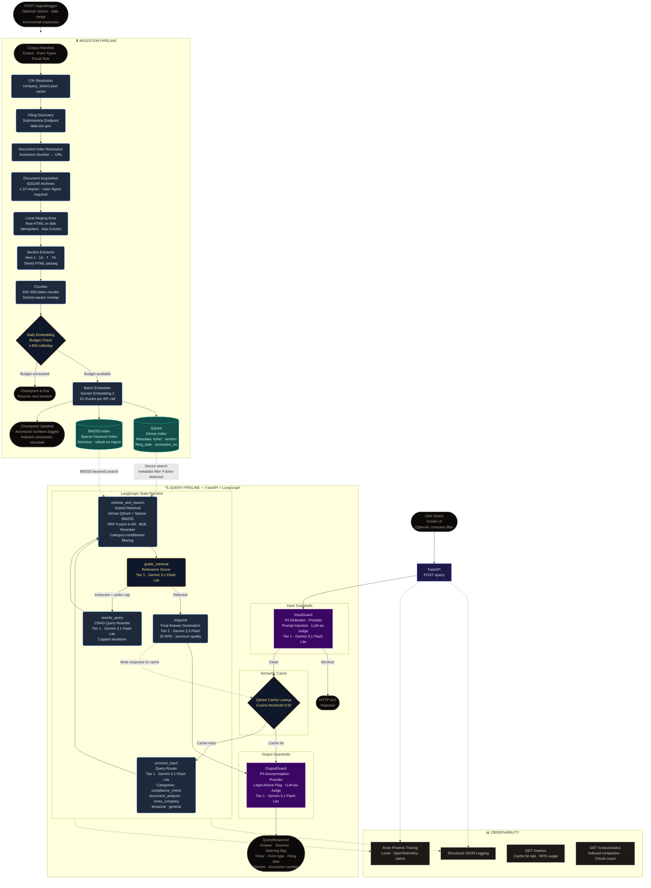

# EDGAR Financial RAG
## A production-grade RAG system for SEC 10-K filing analysis

---

### 1. System Architecture



### 2. Tech Stack

| Component | Technology |
| :--- | :--- |
| Vector Database | Qdrant (local on-disk, Docker-ready) |
| Sparse Retrieval | BM25S (Lucene-standard scoring, directory persistence) |
| Reranker | BGE-Reranker-v2-M3 (cross-encoder, runs fully locally) |
| Semantic Cache | Qdrant (second named collection, cosine similarity) |
| LLM Backbone | Gemini 3.1 Flash Lite (Tier 1, 500 RPD) + Gemini 2.5 Flash (Tier 2, 20 RPD) |
| Embeddings | Gemini Embedding 2 (3072-dim, batch mode, 1K RPD) |
| Agent Orchestration | LangGraph (stateful graph, CRAG loop with corrective retrieval) |
| Data Source | SEC EDGAR API (no auth, 10 req/sec, free) |
| API Layer | FastAPI + uvicorn |
| Frontend | Gradio (Blocks layout, chat + sources panel) |
| Guardrails | Microsoft Presidio (PII) + LLM-as-judge (prompt injection, legal advice) |
| Observability | Arize Phoenix (local, OpenTelemetry-native, RAG-specific metrics) |
| Evaluation | LLM-as-judge harness, 25 EDGAR-specific cases, CI gate (relevance ≥ 0.75) |

### 3. Prerequisites

- Python 3.11+
- GEMINI_API_KEY (Google AI Studio free tier — link: https://aistudio.google.com)
- No Docker required for local development (Qdrant runs on-disk)
- No other paid services or API keys required

### 4. Setup

To install the system dependencies and project package:

```bash
git clone <your-repo-url> && cd edgar-financial-rag
pip install -e .
```

Configure your environment variables:

```bash
cp .env.example .env
# Edit .env: set GEMINI_API_KEY and EDGAR_CONTACT_EMAIL
```

Run the ingestion pipeline to build the corpus:

```bash
ingest
# Ingestion runs across multiple sessions due to the 800-call/day embedding budget.
# Run `ingest` each day until corpus/status shows all 12 companies indexed.
```

### 5. Running

Start the FastAPI backend:

```bash
api          # starts FastAPI on http://localhost:8000
```

Start the Gradio frontend interface:

```bash
gradio       # starts Gradio UI on http://localhost:7860
```

#### API Endpoints
- `POST /query` — submit a compliance question
- `GET /corpus/status` — inspect the current knowledge base
- `GET /metrics` — operational metrics (cache hit rate, RPD usage)
- `GET /health` — liveness check

### 6. Evaluation

Run the automated evaluation suite:

```bash
evaluate
```

Expected stdout format:

```text
+----------------------------+-------+
| metric                     | value |
+----------------------------+-------+
| total_cases                | ...   |
| mean_relevance_score       | ...   |
| mean_citation_score        | ...   |
| mean_citation_source_score | ...   |
| mean_hallucination_score   | ...   |
| cache_hit_rate             | ...   |
| mean_rewrite_count         | ...   |
| mean_retrieved_doc_count   | ...   |
+----------------------------+-------+
```

### 7. Architecture Decisions

- **Why EDGAR filings instead of regulation text as the RAG corpus**
  Direct ingestion of SEC 10-K filings provides actionable, real-world compliance context for financial analysis rather than abstract legal rules. This ensures the RAG system produces practical, company-specific insights grounded in actual reporting behavior.
- **The three-tier Gemini model strategy and why it is necessary on the free tier**
  Operating within stringent Requests Per Day (RPD) limits requires routing computationally light tasks (routing, grading, guardrails) to high-limit Tier 1 models (Gemini 3.1 Flash Lite). Only final synthesis runs on the highly restricted Tier 2 model (Gemini 2.5 Flash), effectively multiplying the system's total functional capacity.
- **Why Qdrant replaces both ChromaDB and FAISS**
  Consolidating dense vector storage into Qdrant eliminates maintaining dual databases, significantly reducing infrastructure complexity and memory footprint. Qdrant provides advanced payload filtering that supports targeted retrieval for specific tickers and form types, directly improving semantic search precision.
- **Why BGE-Reranker-v2-M3 replaces FlashRank**
  BGE-Reranker-v2-M3 natively supports the complex cross-encoder interactions necessary to align long-context financial disclosures with nuanced query intents. This model runs efficiently locally while yielding measurable gains in retrieval relevance over lighter, less capable re-rankers.
- **Why the daily embedding cap is retained (not removed)**
  The daily cap protects the system from unrecoverable rate-limit bans imposed by the free tier API provider during bulk ingestion. A persistent checkpointing mechanism ensures the ingestion seamlessly resumes across days without data loss or duplication.
- **Why Arize Phoenix replaces Langfuse**
  Arize Phoenix runs entirely locally and integrates deeply with OpenTelemetry, keeping sensitive financial queries inside the local network boundary. It provides superior RAG-specific evaluation observability and embedding analysis without external cloud dependencies.
- **The CRAG loop and its value for financial compliance queries**
  Financial RAG fails silently when semantic search returns partially relevant results for complex queries. The Corrective Retrieval Augmented Generation (CRAG) loop actively grades retrieved context and autonomously rewrites queries using domain-specific legal terminology to force a cache miss and retry, preventing hallucinated advice.

### 8. Project Structure

```text
.
├── app
│   ├── gradio_app.py
│   └── streamlit_app.py
├── pyproject.toml
├── README.md
├── src
│   ├── agent
│   │   ├── graph.py
│   │   ├── nodes.py
│   │   ├── router.py
│   │   └── state.py
│   ├── api
│   │   ├── main.py
│   │   ├── routes.py
│   │   ├── run.py
│   │   └── schemas.py
│   ├── core
│   │   ├── config.py
│   │   ├── constants.py
│   │   ├── corpus.py
│   │   ├── embeddings.py
│   │   ├── llm_factory.py
│   │   └── logging.py
│   ├── guardrails
│   │   ├── input_guard.py
│   │   └── output_guard.py
│   └── rag
│       ├── bm25_index.py
│       ├── cache.py
│       ├── edgar_client.py
│       ├── ingest.py
│       ├── retriever.py
│       ├── section_extractor.py
│       └── vector_store.py
└── tests
    └── eval
        ├── eval_dataset.py
        └── run_eval.py
```
