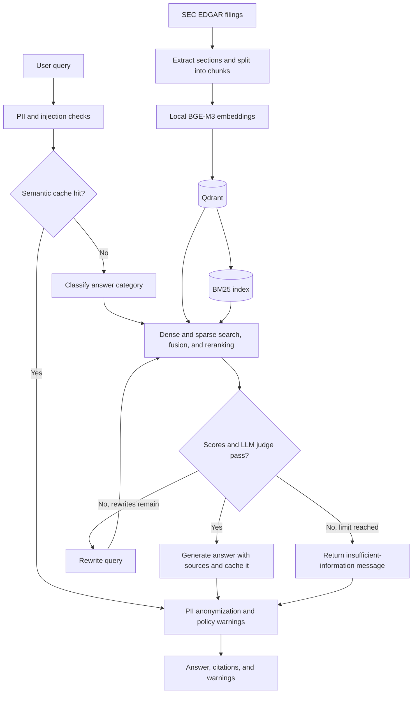

# SEC Filing RAG

Ask questions about SEC 10-K filings through a Gradio interface or FastAPI API.
The system combines dense and keyword retrieval, reranks passages, and retries weak
retrievals with rewritten queries before generating an answer with filing citations.

## Quickstart

Use Python 3.11 or later. From the repository root:

```bash
python -m venv .venv
source .venv/bin/activate
pip install -e ".[dev]"
python -m spacy download en_core_web_lg
cp .env.example .env
```

Set `GROQ_API_KEY`, `GEMINI_API_KEY`, and `EDGAR_CONTACT_EMAIL` in `.env`.
Set `EDGAR_FISCAL_YEAR` to one or more comma-separated report years, such as `2024,2025`.
The [example environment file](.env.example) also lists optional overrides.
For runtime dependencies only, install with `pip install -e .`.

Build the corpus, then start the API:

```bash
ingest
api
```

In another terminal, activate the virtual environment and launch the frontend:

```bash
source .venv/bin/activate
gradio
```

The defaults are [localhost:8000](http://localhost:8000) for the API,
[localhost:8000/docs](http://localhost:8000/docs) for its interactive reference, and
[localhost:7860](http://localhost:7860) for the frontend.

BGE-M3 embeddings and BGE reranking run locally. Weights are downloaded on first use;
the embedding model alone needs roughly 2.3 GB. Qdrant runs as a local file store and
does not require a separate server. Presidio uses the spaCy model installed above.

On Linux with systemd 253 or later and a user session, run commands with a RAM cap and a 2 GiB system
reserve:

```bash
python -m src.core.memory_limit --max-ram-gib 4 -- api
python -m src.core.memory_limit --max-ram-gib 1 -- gradio
```

After installation, `run-limited` is an alias for `python -m src.core.memory_limit`.
The launcher caps the command and its child processes together, disables swap for
them, and reduces the cap if necessary to leave 2 GiB available at startup. It checks
available system RAM once per second and stops the command if it falls below the
reserve. Other applications can still consume RAM between checks. Use
`--reserve-ram-gib` to change the reserve; omit `--max-ram-gib` to use the available
RAM above the reserve. A model that cannot fit will be stopped by the OS; this
does not make large models run in less memory. These limits apply when using the
launcher. GPU VRAM is separate.

## How it works



Ingestion selects recent 10-K filings by report year and extracts Items 1, 1A, 1C, 3, 7,
and 7A, with full-text fallback. It creates 750-character chunks with 150 characters of
overlap and embeds them in batches of five. Completed filings are checkpointed by accession
number; partial embedding failures leave the filing eligible for retry. BM25 is rebuilt
from the stored corpus after a run processes pending filings.

Retrieval fuses dense and sparse rankings using Reciprocal Rank Fusion, then reranks with
a BGE cross-encoder. A detected ticker takes precedence over the selected company filter.
That filter applies to both dense and sparse search. Cached answers are also scoped to
the selected company and retain their citations and retrieval diagnostics.
The graph requires both score thresholds and an LLM relevance verdict to pass, with up to
two query rewrites before returning an insufficient-information response.

PII detection and anonymization run locally. Groq handles injection and policy classification,
query routing, relevance grading, and rewriting. Gemini generates final answers. Policy
violations add a warning; they do not block the answer. Output checks also run on cache hits.
Model assignments and thresholds are in [configuration](src/core/config.py).

Long answers are classified in overlapping chunks to stay within the output guard's
per-request token budget, including a bounded completion allowance. Set
`OUTPUT_GUARD_TPM` to the account's allowance (default: 2,000). The frontend waits up to
`QUERY_TIMEOUT_SECONDS` (default: 300) for model loading and rate-limit pacing.
The other entries in the local rate-limit table need to match the configured account.

## Usage

| Command | Purpose |
| --- | --- |
| `ingest` | Discover and index pending filings |
| `api` | Start the FastAPI service |
| `gradio` | Start the chat interface |
| `phoenix` | Start Phoenix on port 6006 by default |
| `evaluate` | Evaluate answer relevance on completed Phoenix query spans |

For tracing, start `phoenix` and set `PHOENIX_ENABLED=true` before starting the API.
The `evaluate` command uses `GROQ_API_KEY` and requires recorded traces.

| Method | Endpoint | Purpose |
| --- | --- | --- |
| `POST` | `/query` | Answer a question and return citations and diagnostics |
| `GET` | `/health` | Check whether the API is running |
| `GET` | `/corpus/status` | Read indexed companies, chunk count, and checkpoint time |
| `GET` | `/metrics` | Read query counters, cache hit rate, rewrites, and limiter usage |
| `POST` | `/ingest/trigger` | Schedule background ingestion |

```bash
curl http://localhost:8000/query \
  -H 'Content-Type: application/json' \
  -d '{"query":"What risks does AAPL disclose?","session_id":"example","company_filter":"AAPL"}'
```

[Sample questions](eval_queries.txt) cover the configured corpus. They are for manual use;
the Phoenix evaluator reads traces rather than this file.

To change the corpus, edit `KNOWN_TICKERS` in [constants](src/core/constants.py) and run
`ingest` again. Completed accession numbers are skipped. `KNOWN_REGULATIONS` controls
regulation detection for logging and does not change retrieval filters.

## Development

```bash
ruff check .
ruff format --check .
python -m pytest -q
```

CI runs the same checks and installs the spaCy model required by the PII tests.

| Path | Contents |
| --- | --- |
| `app/` | Gradio frontend |
| `src/api/` | HTTP routes, schemas, and service entry points |
| `src/agent/` | LangGraph state, nodes, routing, and prompts |
| `src/rag/` | Filing ingestion, extraction, storage, retrieval, and caching |
| `src/core/` | Configuration, model clients, rate limits, logging, and tracing |
| `src/guardrails/` | Input and output checks |
| `src/eval/` | Phoenix evaluation runner and prompts |
| `tests/` | Unit and convention checks |
| `data/` | Generated filing, checkpoint, and index artifacts; ignored by Git |
| `logs/` | Runtime logs and the [log guide](logs/README.md) |
