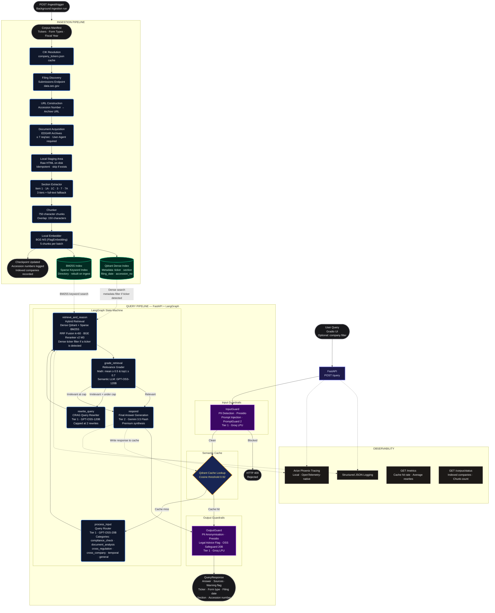

# Agentic RAG for SEC EDGAR Filings

An agentic, corrective retrieval-augmented generation (CRAG) system for analyzing US SEC 10-K filings, detecting compliance risks, and surfacing evidence-grounded financial insights via a hybrid multi-agent architecture.

---

## System Architecture & Data Flow

Below is the complete end-to-end data flow mapping the document ingestion pipeline and stateful LangGraph query engine.



---

## Business Value & Problem Statement

### The Problem

Manual auditing of corporate compliance in sprawling, highly technical SEC EDGAR 10-K filings (often hundreds of pages of dense narrative) is labor-intensive, costly, and prone to oversight. Compliance officers, legal auditors, and financial analysts face significant overhead when cross-referencing company disclosures against shifting regulatory frameworks. Missing a single risk factor or disclosure gap can result in regulatory fines and legal liability.

Traditional linear RAG systems fail silently in this domain for three reasons:

1. **Financial Jargon Complexity:** Vector indexes alone struggle to align specialized financial terminology with ambiguous user queries.
2. **Hallucination & Recall Deficits:** Partially retrieved sections lead to incomplete or incorrect summaries that appear confident.
3. **API Cost & Privacy Barriers:** Enterprise workflows demand local data handling and strict API cost budgets that unmanaged cloud LLM calls cannot satisfy.

### The Solution

**Financial-Compliance-Analyst-AI** addresses these challenges by implementing a stateful **Corrective RAG (CRAG)** system. A hybrid storage architecture combining **Qdrant** (dense vector search) and **BM25S** (sparse keyword matching) feeds a multi-stage retrieval pipeline fused via Reciprocal Rank Fusion (RRF) and BGE Cross-Encoder reranking.

A stateful **LangGraph** engine then orchestrates a set of autonomous nodes — query routing, retrieval, mathematical + semantic grading, and query rewriting — that ensure only verified, relevant context reaches the final generator. Failing retrievals are automatically corrected by rewriting the query with domain-specific SEC terminology.

### Key Engineering Decisions & Their Impact

* **85% API Cost Reduction via Hybrid Model Routing:** High-frequency utility operations (input/output guardrails, query routing, query rewriting, and retrieval grading) are routed to Groq LPUs using lean open-source models. Only the final answer synthesis — which requires a large context window and complex reasoning — is sent to Gemini 3.5 Flash.
* **PII Stays Local:** PII detection and anonymization run on your machine with Microsoft Presidio. A query that contains PII is rejected before anything is sent to Groq, and answers are anonymized locally before the output classifier sees them. The two classifiers, PromptGuard 2-86M (injection) and GPT-OSS-Safeguard-20B (legal advice), run on Groq.
* **Zero Silent Hallucination via Corrective Gates:** Retrieved context passes a two-stage relevance gate (mathematical reranker score thresholds followed by an LLM-as-a-judge) before synthesis. Failed gates trigger automatic query rewriting, capped at two attempts, preventing the system from fabricating answers from irrelevant context.

---

## Ingestion, Storage, & Reasoning Logic

### 1. Ingestion Pipeline

* **Targeted Document Acquisition:** Programmatically queries the SEC EDGAR submissions endpoint (`data.sec.gov`) to discover and resolve accession numbers, fetching the 10-K filings whose fiscal year matches `EDGAR_FISCAL_YEAR` for each company in the corpus manifest. Requests are rate-limited to ≤ 7 req/sec to stay safely within EDGAR's 10 req/sec hard cap.
* **Resilient Parsing & Section Extraction:** **Three extraction tiers plus a full-text fallback** isolate six 10-K sections: **Item 1** (Business), **Item 1A** (Risk Factors), **Item 1C** (Cybersecurity), **Item 3** (Legal Proceedings), **Item 7** (MD&A), and **Item 7A** (Quantitative Market Risk Disclosures). Tiers progress from anchor-based HTML extraction → heading-tag detection → regex text pattern matching, and the whole document text is used if no tier finds a section. The hidden iXBRL header is dropped, while tagged figures in the visible text are kept.
* **Chunking:** Sections are split using `RecursiveCharacterTextSplitter` with a **750-character window** and **150-character overlap**, preserving narrative context across chunk boundaries.
* **Local Dense Embeddings:** The local **BGE-M3 (FlagEmbedding)** model generates **1024-dimensional** dense vectors in batches of 5, using `fp16` precision with normalized output.
* **Idempotent Checkpointing:** A JSON-based checkpoint file tracks processed accession numbers and indexed tickers. A filing is recorded only after every one of its chunks is embedded, so every ingestion run is safe to interrupt and resume without duplication.

### 2. Storage & Retrieval (Hybrid RAG)

* **Dense Retrieval (Qdrant):** Indexes 10-K chunks as 1024-dim vectors with rich metadata payloads (ticker, section, filing date, accession number). A dedicated second Qdrant collection serves as the semantic response cache (cosine threshold: 0.92).
* **Sparse Retrieval (BM25S):** A BM25S keyword index is rebuilt from all Qdrant payloads after every ingestion run, enabling exact-term matching for regulatory clause numbers, legal citations, and financial terminology that dense search can underweight.
* **Fusion & Reranking:** The dense list (filtered to a ticker named in the query, or to the selected company) and the sparse list are merged via **Reciprocal Rank Fusion (RRF, k=60)**, then deduplicated by text content. The merged candidate set is re-scored by **BGE-Reranker-v2-M3** (cross-encoder, running locally), and results below a minimum reranker score of 0.25 are filtered out.

### 3. Orchestration (Multi-Agent LangGraph Workflow)

The graph starts with a **cache-first** routing check before running any LLM:

1. **`cache_check`:** Looks up the query embedding in the Qdrant semantic cache. On a hit, the cached response is passed directly to `respond`, bypassing all retrieval and LLM calls entirely.
2. **`process_input` (Query Router):** On a cache miss, `GPT-OSS-20B` (via Groq) classifies the query into one of six categories: `compliance_check`, `document_analysis`, `cross_regulation`, `cross_company`, `temporal`, or `general`. The category controls the structured output template used during generation.
3. **`retrieve_and_reason` (Hybrid Retrieval + Grading):** Executes the full hybrid retrieval pipeline. Retrieved chunks are evaluated inline using both a mathematical gate (mean reranker score ≥ 0.50 **and** top-1 score ≥ 0.70) and an LLM-as-a-judge (`GPT-OSS-120B` via Groq) that verifies topic, entity, and temporal match.
4. **`grade_retrieval`:** Reads the relevance verdict from state and routes the graph: relevant context proceeds to `respond`; irrelevant context with rewrites remaining routes to `rewrite_query`.
5. **`rewrite_query` (CRAG Rewriter):** `GPT-OSS-120B` rewrites the query using formal SEC/CFR terminology and explicit item-level references. The rewrite loop is capped at **2 attempts**; if both fail, `respond` returns a fixed "could not find sufficient information" message instead of generating an answer from irrelevant context.
6. **`respond` (Generation):** `Gemini 3.5 Flash` synthesizes a structured, citation-grounded answer using a category-specific prompt template. The response and sources are written to the semantic cache.

### 4. Generation & LLM Routing

* **Groq LPU (Tier 1):** Handles all high-frequency, low-latency model calls: prompt injection classification (PromptGuard 2-86M), query routing (GPT-OSS-20B), retrieval grading (GPT-OSS-120B), query rewriting (GPT-OSS-120B), and legal advice flagging (GPT-OSS-Safeguard-20B). PII detection runs locally in Presidio.
* **Gemini 3.5 Flash (Tier 2):** Handles final answer synthesis only, using its large context window to reason across multiple cross-company filing excerpts.
* **Structured Output Enforcement:** The generation prompt enforces a strict section-by-section output format with mandatory inline citations (`[TICKER FORM_TYPE FILING_DATE — SECTION]`) and a legal disclaimer footer.
* **Rate-Limited Invocation:** All LLM calls pass through a sliding-window rate limiter before hitting the API, with exponential backoff retry for transient 429 errors.

---

## Tech Stack

| Category | Technology | Role |
| :--- | :--- | :--- |
| **Orchestration** | `LangGraph`, `LangChain` | Stateful CRAG graph, node wiring, and LLM abstractions |
| **API Layer** | `FastAPI`, `uvicorn` | REST endpoints, request validation, and background ingestion |
| **Vector Store & Cache** | `Qdrant` (on-disk) | Dense retrieval collection + semantic response cache collection |
| **Sparse Index** | `BM25S` | Keyword search index, rebuilt from Qdrant payloads after each ingest |
| **Reranker** | `BGE-Reranker-v2-M3` | Local cross-encoder reranking via `sentence-transformers` |
| **Embeddings** | `BGE-M3` (`FlagEmbedding`) | 1024-dim local dense embeddings, `fp16`, normalized |
| **Generation** | `Gemini 3.5 Flash` | Final answer synthesis via `langchain-google-genai` |
| **Utility LLMs** | `GPT-OSS-20B`, `GPT-OSS-120B` | Query routing (20B) and CRAG grading and rewriting (120B), via Groq LPU |
| **Input Guardrail** | `Microsoft Presidio` + `PromptGuard 2-86M` | PII detection; prompt injection classification (Groq) |
| **Output Guardrail** | `Microsoft Presidio` + `GPT-OSS-Safeguard-20B` | PII anonymization; legal advice detection (Groq) |
| **Observability** | `Arize Phoenix`, `OpenTelemetry` | Local LLM tracing and span export (opt-in via `PHOENIX_ENABLED=true`) |
| **Frontend** | `Gradio (Blocks)` | Chat UI with source citation panel |

---

## Quickstart

### Prerequisites

* **Python 3.11+** runtime environment
* **`GEMINI_API_KEY`** — [Google AI Studio](https://aistudio.google.com) (free tier)
* **`GROQ_API_KEY`** — [Groq Cloud](https://console.groq.com) (free tier)
* **`EDGAR_CONTACT_EMAIL`** — Required by SEC EDGAR as the `User-Agent` header value (e.g., `analyst@example.com`)
* **`EDGAR_FISCAL_YEAR`** — One or more comma-separated fiscal years of 10-K filings to ingest (e.g., `2024,2025`)

### Environment Configuration

Copy the example file and fill in your values:

```bash
cp .env.example .env
```

[`.env.example`](.env.example) lists every setting with its default and a short explanation.

### Step-by-Step Setup

**1. Clone and create a virtual environment:**

```bash
git clone <your-repo-url> && cd financial-compliance-analyst-ai
python -m venv .venv && source .venv/bin/activate
pip install -e .
python -m spacy download en_core_web_lg
```

The spaCy model is used by Presidio for PII detection. To run the tests and the linter as well, install the dev extra with `pip install -e .[dev]` instead of `pip install -e .`.

**2. Run the ingestion pipeline:**

Ingest the corpus. Checkpoints are saved after each filing so you can safely interrupt and resume:

```bash
ingest
```

> BGE-M3 weights (~2.3 GB) are downloaded on the first run. Embeddings are computed locally, in batches of 5 chunks.

**Customizing the Corpus (Adding Companies & Regulations):**
By default, the system indexes a predefined set of 12 major companies and recognizes common SEC regulations. To customize these:

1. Open `src/core/constants.py`.
2. **Add Companies:** Append your target companies' ticker symbols to the `KNOWN_TICKERS` list:

   ```python
   KNOWN_TICKERS = [
       # ... existing companies ...
       "TSLA",
   ]
   ```

3. **Add Regulations:** If your queries frequently reference specific CFR clauses or niche regulations, add them to `KNOWN_REGULATIONS`. A regulation named in a query is logged when detected; it does not change which documents are retrieved.
4. Re-run the `ingest` command. The idempotent checkpointer will automatically skip previously processed companies and only fetch the new ones.

**3. Start the FastAPI backend:**

```bash
api
```

FastAPI is available at [http://localhost:8000](http://localhost:8000).

**4. Launch the Gradio frontend:**

```bash
gradio
```

Open [http://localhost:7860](http://localhost:7860) for the interactive chat UI with source citation panel.

### Commands

| Command | What it does |
| :--- | :--- |
| `pip install -e .` | Install the runtime dependencies and the console commands below |
| `pip install -e .[dev]` | Also install `pytest` and `ruff` |
| `ingest` | Download, chunk, embed and index the filings, then rebuild the BM25 index |
| `api` | Start the FastAPI backend on port 8000 |
| `gradio` | Start the Gradio chat UI on port 7860 |
| `phoenix` | Start the Arize Phoenix tracing server on port 6006 |
| `evaluate` | Run the LLM-as-a-judge evaluations over traces recorded in Phoenix |
| `python -m pytest` | Run the unit tests |
| `ruff check . && ruff format --check .` | Lint and check formatting |

### API Endpoints

| Method | Path | Description |
| :--- | :--- | :--- |
| `POST` | `/query` | Submit a compliance question |
| `GET` | `/corpus/status` | Inspect indexed companies and chunk count |
| `GET` | `/metrics` | Operational metrics (query count, cache hit rate, average rewrites, rate limiter usage) |
| `GET` | `/health` | Liveness check |
| `POST` | `/ingest/trigger` | Trigger a background ingestion run |

---

## Future Scope

1. **Structured Table & Financial Statement Parsing:** Upgrade document parsing to extract tabular data (balance sheets, income statements) as structured nodes rather than raw text, enabling precise numerical queries.
2. **Multi-Year Comparative Knowledge Graph:** Build a Neo4j graph layer tracking entity relationships across consecutive fiscal years, enabling detection of changes in risk language, executive disclosures, and cited regulatory references over time.
3. **Real-Time Filing Alerts:** Monitor the SEC EDGAR RSS feed to automatically trigger ingestion and re-indexing as soon as target companies publish new filings, keeping the corpus current without manual intervention.

---

## Project Structure

Generated from the files tracked in git, plus the runtime folders. `data/` and the `*.log` files under `logs/` are created at runtime and are git-ignored.

```text
.
├── .env.example
├── .github
│   └── workflows
│       └── ci.yml
├── .gitignore
├── app
│   ├── __init__.py
│   └── gradio_app.py
├── data                      # runtime, git-ignored
│   ├── .ingest_checkpoint.json
│   ├── company_tickers.json
│   ├── edgar_staging
│   ├── indexes
│   └── vectorstore
├── eval_queries.txt
├── logs
│   ├── README.md
│   ├── api
│   ├── app
│   ├── audit
│   ├── phoenix
│   ├── rag
│   └── system
├── pyproject.toml
├── README.md
├── src
│   ├── __init__.py
│   ├── agent
│   │   ├── __init__.py
│   │   ├── graph.py
│   │   ├── nodes.py
│   │   ├── prompts.py
│   │   ├── router.py
│   │   └── state.py
│   ├── api
│   │   ├── __init__.py
│   │   ├── main.py
│   │   ├── routes.py
│   │   ├── run.py
│   │   └── schemas.py
│   ├── core
│   │   ├── __init__.py
│   │   ├── config.py
│   │   ├── constants.py
│   │   ├── corpus.py
│   │   ├── embeddings.py
│   │   ├── fileio.py
│   │   ├── lazy.py
│   │   ├── llm_factory.py
│   │   ├── logging.py
│   │   ├── rate_limiter.py
│   │   └── tracing.py
│   ├── eval
│   │   ├── __init__.py
│   │   ├── prompts.py
│   │   └── run_phoenix_evals.py
│   ├── guardrails
│   │   ├── __init__.py
│   │   ├── input_guard.py
│   │   ├── output_guard.py
│   │   └── pii.py
│   └── rag
│       ├── __init__.py
│       ├── bm25_index.py
│       ├── cache.py
│       ├── edgar_client.py
│       ├── ingest.py
│       ├── retriever.py
│       ├── section_extractor.py
│       └── vector_store.py
└── tests
    ├── __init__.py
    └── unit
        ├── __init__.py
        ├── conftest.py
        ├── test_bm25_index.py
        ├── test_conventions.py
        ├── test_edgar_client.py
        ├── test_gradio_app.py
        ├── test_ingest.py
        ├── test_input_guard.py
        ├── test_llm_factory.py
        ├── test_nodes.py
        ├── test_output_guard.py
        ├── test_rate_limiter.py
        ├── test_retriever.py
        ├── test_section_extractor.py
        └── test_tracing.py
```
